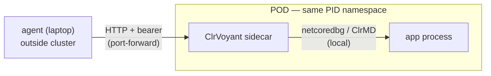

# Remote debugging in a POD

ClrVoyant can run **inside a Kubernetes POD** as a sidecar so an agent can debug a
.NET app running in the cluster. This was de-risked by the Linux spike
([../spike/linux/FINDINGS.md](../spike/linux/FINDINGS.md)).

## What "remote" means here

Only the **agent ↔ server** link is remote (over HTTP). The debug engine is
**local** to the target:

```
  agent (laptop)  ──HTTP + bearer──►  ClrVoyant sidecar  ──netcoredbg/ClrMD──►  app process
  (outside cluster)   port-forward       (in the POD)        (same POD, same PID ns)
```



netcoredbg and ClrMD have no network attach — they read the app process locally.
So ClrVoyant must be **co-located with the app** (sidecar in the same POD, sharing
the PID namespace). HTTP transport is what lets the agent reach it from outside.

## Pieces

- **[Dockerfile](Dockerfile)** — builds the Linux image on the .NET 10 SDK and
  ASP.NET Core images: publishes the server and bundles the architecture-matching
  `netcoredbg` (linux-x64, or linux-arm64 when built with
  `docker buildx build --platform linux/arm64`). HTTP transport; no token baked in. The
  image sets `CLRVOYANT_HTTP_URL=http://0.0.0.0:3001` **explicitly**: the server's own
  default is loopback, and a sidecar is reached through the pod network (the server logs
  a warning for the non-loopback bind).
- **[clrvoyant-sidecar.yaml](clrvoyant-sidecar.yaml)** — a Deployment with
  `shareProcessNamespace: true`, the app container, and the ClrVoyant sidecar with
  `CAP_SYS_PTRACE` and the auth token from a Secret that **you create** with
  `kubectl create secret` (the manifest ships no token, so applying it unedited
  cannot deploy a known one). It also sets `allowPrivilegeEscalation: false`, the
  `RuntimeDefault` seccomp profile and resource requests/limits (heap inspection
  is memory-hungry: size the memory limit to the app's heap). A stricter
  non-root / read-only-filesystem profile is included as a commented, **untested**
  block.

**Pin the image by version.** The manifest uses `your-registry/clrvoyant:X.Y.Z`,
not `:latest`: a mutable tag lets the container that can attach to and evaluate
code in your app change silently on the next pull. Build and push an explicit
version tag and put it in the `image:` line.

## Requirements

1. **PDBs in the app image** — without `.pdb` files you get no source lines or
   locals (only native/IL-level). Ship a debug-friendly image.
2. **`CAP_SYS_PTRACE`** on the sidecar — netcoredbg attaches via ptrace and ClrMD
   reads `/proc/<pid>/mem`. Hardened clusters drop this by default; it must be
   added (see the manifest). `shareProcessNamespace: true` is also required.
3. **Same architecture + .NET 8+** for app and sidecar. The sidecar image must
   match the node/app architecture (`linux-x64` or `linux-arm64`) — the engine
   debugs locally and cannot cross architectures. Build the arm64 image with
   `docker buildx build --platform linux/arm64 -f deploy/Dockerfile .`.

## Connect an agent

```sh
# 1) Build & push the image under an explicit version tag (not :latest)
docker build -t your-registry/clrvoyant:X.Y.Z -f deploy/Dockerfile .
docker push your-registry/clrvoyant:X.Y.Z

# 2) Create the auth Secret (a strong random token; the manifest contains none)
kubectl create secret generic clrvoyant-auth \
  --from-literal=token="$(openssl rand -hex 32)"

# 3) Put the same X.Y.Z in the manifest's `image:` line, then apply
kubectl apply -f deploy/clrvoyant-sidecar.yaml

# 4) Forward the MCP port (keep it cluster-internal — no public Ingress)
kubectl port-forward deploy/my-app-with-debugger 3001:3001
```

Point your MCP client at the HTTP endpoint with the bearer token:

```json
{
  "mcpServers": {
    "clrvoyant-pod": {
      "type": "http",
      "url": "http://127.0.0.1:3001",
      "headers": { "Authorization": "Bearer <the-secret-token>" }
    }
  }
}
```

Then have the agent **attach to the app process**: in the shared PID namespace the
app is visible from the sidecar, so the agent calls `list_processes()` to find the
app's pid and `debug_attach(<pid>)` to attach to it. From there `set_breakpoint`,
`continue`, `list_tasks`, etc. behave exactly as locally. Enabling
`set_auto_attach(true)` makes the sidecar discover .NET children via `/proc` too.

## Security posture (read before deploying)

An authenticated caller can attach a debugger, set breakpoints, and **evaluate
code** in the app process — i.e. arbitrary code execution in that POD. Therefore:

- The server **fails closed**: HTTP refuses to start without `CLRVOYANT_AUTH_TOKEN`.
  Failed authentications are logged with the caller's address (`auth -> denied
  remote=<address>`; behind `port-forward` that is the forwarder's address).
- The token gives full control of every debug session on the sidecar, with no per-caller
  identity. That includes `debug_launch` with arbitrary environment variables (for
  example `DOTNET_STARTUP_HOOKS`, which loads an assembly into the new process) and
  `list_processes`, whose command lines can contain secrets.
- Keep the endpoint **cluster-internal** (ClusterIP + `port-forward`, or mTLS).
  Do **not** expose it via a public Service/Ingress.
- The shipped manifest adds only `SYS_PTRACE` (it does not drop the other default
  capabilities) and enables `allowPrivilegeEscalation: false` and the `RuntimeDefault`
  seccomp profile. The non-root / drop-all-capabilities profile is **untested** and left
  commented out.
- You build the image yourself from this repository. The release artefacts (the NuGet
  package) come with a `SHA256SUMS` file and a build-provenance attestation; how to
  verify them is in the supply-chain section of [docs/security.md](../docs/security.md).
- Treat this as a **break-glass / non-prod** capability; rotate the token by
  redeploying (it is read once at startup), and use a `NetworkPolicy` to restrict who
  can reach port 3001.
