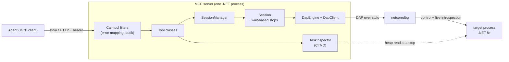

# Architecture

This describes ClrVoyant as it is built. For *why* the big decisions were made, see
the [ADRs](adr/README.md). The pre-implementation plan is kept for history only, in
[archive/IMPLEMENTATION_PLAN.md](archive/IMPLEMENTATION_PLAN.md); do not use it as a
reference.

## Overview

ClrVoyant is a single .NET process: an **MCP server** that lets an agent debug .NET
8/9/10 apps headlessly. It orchestrates **two engines** against a target, behind
**one IDE-neutral tool contract** ([ADR-0002](adr/0002-two-engines-one-contract.md)):

- **netcoredbg over DAP**: control and live introspection (breakpoints, step,
  threads, call stack, variables, evaluate).
- **ClrMD**: reads the heap at a stop to enumerate `Task`s and reconstruct the async
  await/continuation graph (the "Tasks window" DAP cannot provide).

## Projects

| Project | Responsibility |
|---|---|
| `ClrVoyant.Core` | Models, `IDebugEngine` (the engine contract), `Session`, `SessionManager`, `BreakpointLocator`, `Page`/`Paging`, `BoundedTextTail`. No engine or file-system specifics. |
| `ClrVoyant.Dap` | `DapClient` (DAP framing, request/response correlation, event pump, closed state) and `DapEngine` (`IDebugEngine` over netcoredbg). |
| `ClrVoyant.Inspection` | `TaskInspector` (ClrMD heap read, Task status decoding, async state-machine walking, graph reconstruction) and `AssemblyMethodScanner` (static metadata read for no-source method discovery). |
| `ClrVoyant.Server` | The MCP host: tool classes (`Tools/`), the one MCP registration (`McpRegistration`), the call-tool filters (`ToolErrors`, `AuditLog`), transports and wiring (`HostFactory`, `BearerAuthMiddleware`), `NetcoredbgLocator` / `NetcoredbgFetcher`, `ChildProcessWatcher`, `ProcessLister`, `TestDebugLauncher`. |
| `tools/` | The scripts that fetch netcoredbg at build time. The engine itself is not committed: it is fetched, verified and bundled ([ADR-0006](adr/0006-bundle-netcoredbg.md)). |
| `samples/` | Debug targets for tests and demos: `SampleApp`, `ParentApp` (both net8.0/net9.0/net10.0), `WinFormsApp` (Windows only). |
| `spike/` | Historical de-risking experiments; not built by the solution ([spike/README.md](../spike/README.md)). |

The server, libraries and tests target net10.0 ([ADR-0003](adr/0003-modern-dotnet-only.md)).

## Key designs

### One MCP registration and the request pipeline
`McpRegistration.AddClrVoyantMcpServer()` is the only place the MCP server is
configured: it registers every `[McpServerToolType]` class of the assembly, sets the
playbook as the server instructions (sent in `initialize`), and adds two **call-tool
filters**. Stdio, HTTP and the tests all go through it, so a test exercises what runs.

Filter order matters (the first registered is the outermost):

1. `ToolErrors`: turns a failed call into an error result carrying the actionable
   message ([ADR-0012](adr/0012-tool-errors-as-results.md)). Cancellation and JSON-RPC
   protocol errors pass through.
2. `AuditLog`: logs `tools/call <tool> -> ok | error | canceled` (and the remote address
   over HTTP). It sits inside the error filter so it sees the original exception.

### Wait-based execution ([ADR-0004](adr/0004-wait-based-execution-model.md))
`continue`/`step_*` block until the next stop, exit, lost connection or timeout and
return the new state. A resume arms a *targeted waiter*; the next event completes it.
An event with no waiter (an idle breakpoint, `stopAtEntry`, a process dying unobserved)
is *spontaneous* and fans into `wait_for_any_stop`. One resume may be in flight per
session; cancelling a resume disarms its waiter instead of swallowing the next event.

### A DAP client with a closed state
`DapClient` is either open or closed, and closing is terminal. It closes once, on
whichever happens first: end of the adapter's output, a read/framing failure, a failed
write, or disposal. Closing fails every pending request and makes later ones fail
immediately with the same error, which names the cause and, for a spawned adapter, its
exit code and the tail of its stderr. Every request has a timeout (default 30 s;
launch/attach are bounded by the engine's own 15 s ready timeout, `disconnect` by 5 s)
and is cancellable. An engine whose client closed reports `Faulted` unless the debuggee
had already ended, and raises its `Faulted` event so a waiting resume ends at once.

### Multi-session and ownership ([ADR-0005](adr/0005-multi-session-from-the-start.md))
`SessionManager` owns the sessions; every session-scoped tool takes an optional
`sessionId`. Events no resume was waiting for are fanned into one channel; each carries
the session's stop sequence so `wait_for_any_stop` can drop events that are no longer
true. Starting a session is transactional: a failed launch/attach unregisters the
session, restores the previously active one and ends its engine.

Each session knows whether this server **owns** its debuggee: launched by
`debug_launch`, started as the `dotnet test` host of `debug_test`, or auto-attached from
a session that is owned. `debug_stop` kills owned debuggees and detaches from the rest
(`terminate` overrides). A session may also own a resource (the `dotnet test` driver)
that is disposed with it.

### Two identity spaces
DAP handles (`frameId`, `variablesReference`) are invalidated on every resume;
ClrMD addresses are valid within a heap read. Both are scoped to a stop: `Session`
bumps a `StopId` on every stop, and the ClrMD read is cached per `(pid, StopId)`, so
`list_tasks`, `get_async_graph` and `get_task` at one stop read the heap once. The
cache entry of a process is dropped when that process is gone (`DebuggeeEnded`).

### Breakpoint store
DAP `setBreakpoints` replaces all breakpoints for a file, so `Session` keeps the desired
set per file and assigns stable ids, re-sending the full set on each change (and after a
restart). Paths compare case-insensitively on Windows only, and the engine is always
given the first spelling seen. `set_breakpoint` can resolve a line by **source text**
(`content`) via `BreakpointLocator`, robust to line drift. Function breakpoints are one
global set with ids shared with source breakpoints.

### Bounded results ([ADR-0013](adr/0013-bounded-paged-tool-results.md))
The tools that enumerate runtime objects return a page (`items`, `total?`, `truncated`,
`nextOffset?`); `get_variables` asks the debugger for one window plus a lookahead item
instead of everything. The debuggee's output is kept as a bounded tail (64 KiB).

### Lazy engine resolution ([ADR-0006](adr/0006-bundle-netcoredbg.md))
The server does not need netcoredbg to start. `HostFactory` hands the `SessionManager`
an engine factory that locates the executable on the **first session start**
(`NetcoredbgLocator`: `CLRVOYANT_NETCOREDBG`, then the per-RID bundle, then the flat
bundle, then the stamped user cache, fetching on first use). A failure becomes the error
of that first `debug_launch`/`debug_attach`/`debug_test`; only a success is remembered.

### Cross-OS heap read ([ADR-0008](adr/0008-cross-os-heap-read.md))
`TaskInspector.OpenDataTarget`: Windows uses a PSS snapshot
(`CreateSnapshotAndAttach`); Linux a passive read (`AttachToProcess(suspend:false)`,
read-only `/proc/<pid>/mem`, no second ptrace stop). Shown to coexist with netcoredbg
holding the process.

### Transports ([ADR-0009](adr/0009-http-transport-mandatory-auth.md))
`HostFactory.RunAsync` selects by `CLRVOYANT_TRANSPORT`:

- **stdio** (default): console host, logging to stderr (stdout is the JSON-RPC stream).
- **http**: ASP.NET Core `WebApplication` + `MapMcp()`, **stateless** MCP sessions, a
  bearer-token middleware in front of everything, fail-closed without a token, binding
  `127.0.0.1:3001` unless `CLRVOYANT_HTTP_URL` says otherwise (a warning is logged for
  any non-loopback address). For the POD topology see
  [remote-debugging-pod.md](remote-debugging-pod.md).

## Notable gotchas (encoded in the code)

- Breakpoint source paths must be full OS paths (`Path.GetFullPath`) to match the PDB.
- Debug builds emit async state machines as a **class**, Release as a **struct**;
  the ClrMD awaiter walk tries both (`ReadObjectField`, then `ReadValueTypeField`).
- netcoredbg often returns `verified=false` and binds asynchronously through a
  `breakpoint` event; `set_breakpoint` waits (event-driven, at most 600 ms) for the flip.
- netcoredbg's `pause` on a freely running target is unreliable; the wait-based model
  and breakpoints are the deterministic path.
- Async-state-machine line breakpoints can be flaky on netcoredbg; synchronous,
  repeatedly executed lines bind reliably (matters mainly for spikes and tests).

## Where to go next

- Tool reference: [tools.md](tools.md)
- Security model: [security.md](security.md)
- Tests: [testing.md](testing.md)
- POD/remote: [remote-debugging-pod.md](remote-debugging-pod.md)
